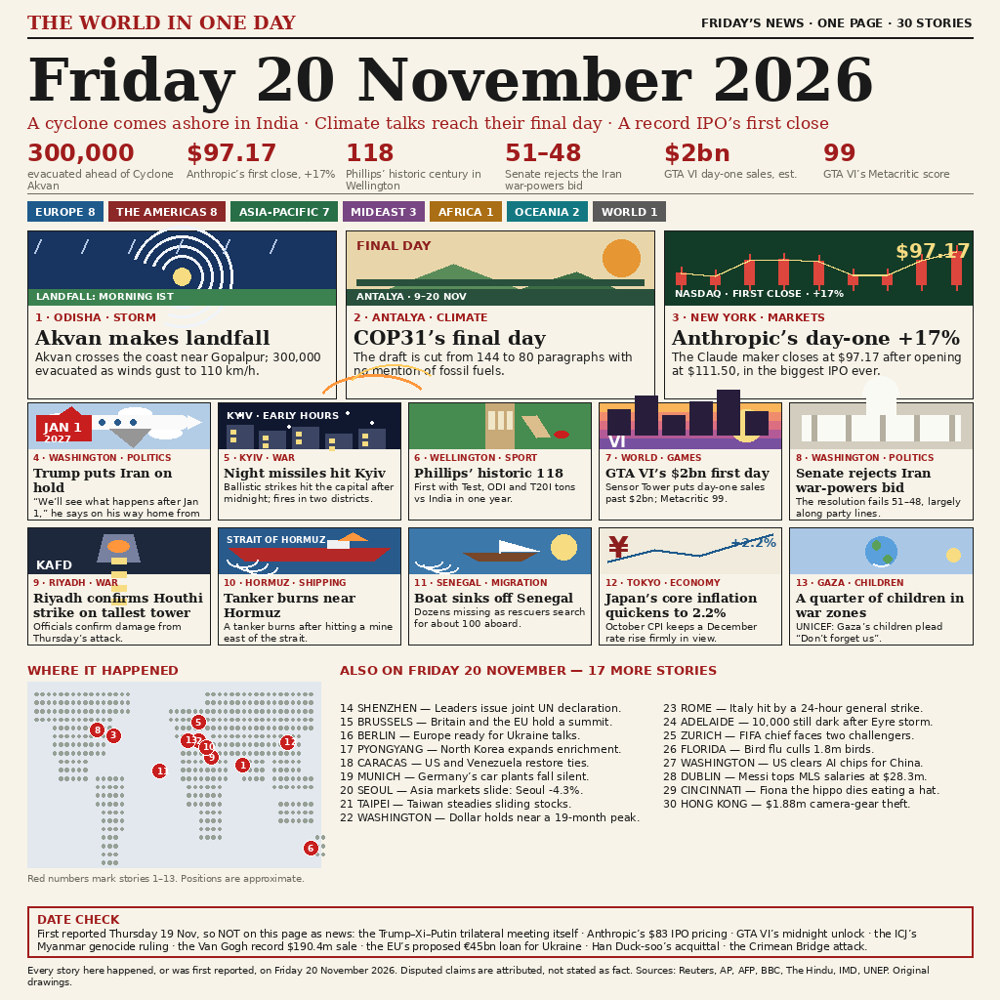

# The World in One Day — 30 Stories, One Front Page

An entry for the [make.fun](https://make.fun) bounty [Sum up 20 November's world news in one image](https://make.fun/bounty/news-image-20261120).

## The page

One front page for **Friday 20 November 2026**, in the order the judge weighs:

1. **The day, named loud.** A masthead and a full-width date headline — *Friday 20 November 2026* — plus a sub-headline naming the three biggest stories of the day.
2. **Breadth with selection.** 30 stories across 7 regions and every beat that mattered: Cyclone Akvan's landfall in Odisha (~300,000 evacuated), COP31's final day in Antalya, Anthropic's first close at $97.17 (+17% on its record IPO), Trump deferring the Iran decision to 2027, the Senate rejecting the Iran war-powers bid 51–48, ballistic missiles over Kyiv, Phillips' historic 118 in Wellington, GTA VI passing $2bn on day one, a tanker fire near Hormuz, a migrant boat sinking off Senegal, Japan's core CPI at 2.2%, and UNICEF's World Children's Day warning that 1 in 4 children live in war zones.
3. **It reads.** 3 large illustrated lead panels and 10 small illustrated cards — every lead story has its own flat drawing — a stat strip of the day's big numbers, region chips, a dot-map of where it happened, and a dense numbered list for the remaining 17 stories.
4. **Faithful.** Every story was verified against a live source (Reuters, AP, AFP, BBC, The Hindu, IMD, UNEP) before it went on the page. A **DATE CHECK** box lists the big stories first reported on Thursday 19 November — the trilateral meeting itself, Anthropic's $83 IPO pricing, GTA VI's midnight unlock, the ICJ's Myanmar ruling, the Van Gogh record sale, the EU's proposed €45bn Ukraine loan, Han Duck-soo's acquittal, the Crimean Bridge attack — and keeps them off the page as news, so nothing stale is presented as Friday's.
5. **Craft.** One composition, drawn cleanly, legible at 300 pixels across: no smears, no garbled text, no overflow.

## How it works

`main.py` (Python 3.13, standard library only) copies the repository-held `entry.png` to `/output/entry.png`. The page itself was drawn at build time with a PIL renderer and every story was checked against live sources first. The program runs twice and writes byte-identical output.

## Sources

Reuters, AP, AFP, BBC, The Hindu, IMD, UNEP. Original drawings.

## License

MIT — see [LICENSE](LICENSE).
